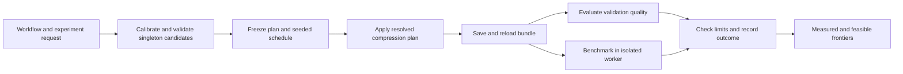

# Compression experiment planner

The planner targets methods exposed by the candidate analyzer that save
estimated tensor bytes and can be reconstructed by the PyTorch bundle loader.
The isolated worker can reconstruct TorchVision, Segmentation Models PyTorch,
and Transformers models. The current scope is Linux, PyTorch CPU or CUDA,
and the analyzer's classification, segmentation, detection, or causal-LM
task adapters.

## Request, evidence, and execution



The workflow's `experiment` object is a versioned request with a fixed
`device` (`cpu`, `cuda`, or `cuda:N`), `runtime` (`pytorch`),
`max_trials_per_strategy`, `seed`, `max_quality_loss`,
`max_serialized_bytes`, `max_memory_bytes`, and `max_latency_ms`.
The quality metric and direction come from the existing task adapter.
Limits are inclusive. Quality loss is the absolute amount of degradation in
the configured metric's units relative to the reloaded dense reference. An
improvement is a negative loss. The model/data seed and benchmark seed are
separate workflow settings.

The current analyzer performs bounded local calibration and singleton
interventions on the validation split. This shared screen, the reference
quality evaluations, and the dense benchmark are common setup. The per-strategy
budget counts new whole-configuration attempts after setup, including
failed and interrupted attempts. The shared analyzer evidence reports
calibrated, validated, and failed candidates with their decisions. Narrow
`analysis.include`, `candidate_grid`, and `max_validated_per_layer` to
control the cost of screening. Benchmark `timeout` applies to each isolated
worker. The experiment budget is a count of attempts.

The three strategies use the same structurally eligible, screened pool, with
checkpoint and runtime support required. Within a configuration, edits must
target distinct, nonoverlapping module paths.

| Strategy | How it spends the budget |
| --- | --- |
| Evidence | Build configurations from singleton edits and prefixes of three greedy chains ordered by predicted quality loss, savings, and loss per byte. Prefer estimated size and quality feasibility, then spread trials across savings targets. |
| Current | Use the analyzer's measured damage-per-byte order and keep cumulative edits that pass the validation quality bound. Start another walk at dense after reaching the serialized cap. If a walk exhausts compatible edits, spend remaining slots on untried singleton configurations in the same order. |
| Random | Shuffle the same pool and sample compatible prefixes, skipping repeats. Fill any unused slots with randomly ordered untried singleton configurations. |

The validator requires at least as many distinct compatible singleton edits
as the requested trial count. Each strategy gets one slot per round in a
seeded order. The strategies run sequentially under the same benchmark
settings. Matching configurations across strategies each consume an attempt
and receive an independent measurement. Random sampling uses shuffled orders
and prefix lengths with one seed per run. Configurations can have different
sampling probabilities.

The evidence strategy uses additive singleton quality deltas and tensor-byte
savings as search heuristics. Layer interactions can invalidate the quality
estimate, and bundle headers can change serialized size. Runtime and memory
limits are decided from isolated measurements of the reconstructed bundle.
A full grid would grow combinatorially across layers. An adaptive optimizer
could learn interactions or hardware performance from trials, but adds model
fit and exploration overhead when there are only a few observations. The
bounded greedy chains and singleton candidates reuse the repository's evidence
with no additional evaluation or dependencies.

## Files and interpretation

| Artifact | Contents |
| --- | --- |
| `request.json` | Validated request, workflow, model and data fingerprints, validation IDs, exact workload, software, and host/device identity |
| `evidence.json` | Analyzer schema with candidate IDs, estimates, resolved configurations, capabilities, and singleton measurements |
| `plan.json` | Versioned schedule, fixed evidence and random configurations, and ordered candidate IDs for the current strategy |
| `original/`, `baseline.json` | Reloadable dense bundle and reference evaluation and benchmark |
| `trials/<trial-id>/attempt.json` | Configuration recorded before the attempt starts |
| `trials/<trial-id>/bundle/`, `result.json` | Transformed bundle when saved, checksum and available measurements, status, and constraint violations or error |
| `experiment.json` | All outcomes, shared screen counts, both global frontiers, and each strategy's feasible frontier |

Each objective retains its own units. Size is the sum of serialized bundle
file lengths. Memory is sampled inference process RSS on CPU or peak
CUDA allocator bytes on GPU. CPU RSS includes Python and model load
residency and is sampled every 5 ms, so short spikes can go unseen. CUDA
allocated bytes cover live tensors tracked by PyTorch's allocator. Latency
is p50 of a full forward or, for causal LMs, a fixed-length cached generation
request including its Python loop. Batch/shape, repetitions, warmups, threads,
precision, and raw latency samples accompany the benchmark results. Latency
and memory comparisons apply within a run on the recorded host.

A feasible frontier can be empty. Exact ties remain on the frontier, and very
small latency differences can be measurement noise. Selection uses validation
quality. Confirm a chosen candidate on the test split with the existing
`tn-compress evaluate --role test` workflow before drawing generalization
conclusions. The CPU example only exercises the protocol.

Resume by repeating the command and output directory on the same Linux host
and boot with the same inputs and runtime. The runner compares the frozen
request and plan, including fingerprints of model weights, data, and code.
It reuses completed outcomes and marks any started attempt without a final
record as interrupted. Change the output directory for a new seed, host,
version, or budget.

## Recorded CPU experiment

The [CPU configuration](../examples/configs/experiment-cpu.yaml) seeded a
randomly initialized ResNet-18 with 17. It used 24 synthetic examples per
split, data seed 23, search seed 31, and benchmark seed 47. The common analyzer
screen calibrated and validated 12 candidates. Measurements ran on one AMD
EPYC 9V74 host with Linux 6.18.57, Python 3.12.14, PyTorch 2.6.0+cpu, and
TorchVision 0.21.0+cpu. Each worker used one thread, five warmups, and 50
timed forwards of a fixed seeded tensor with shape `[1, 3, 32, 32]`.

| Strategy | Accepted / attempted | Smallest feasible trial | Validation loss | Serialized bytes | Inference RSS peak (bytes) | p50 (ms) |
| --- | ---: | --- | ---: | ---: | ---: | ---: |
| Dense reference | — | — | 1.097339 | 44,792,674 | 417,849,344 | 6.331 |
| Evidence | 4 / 4 | `evidence-0004` | 1.100300 | 18,968,878 | 406,507,520 | 4.252 |
| Current | 2 / 4 | `current-0002` | 1.094496 | 33,430,864 | 434,946,048 | 5.333 |
| Random | 2 / 4 | `random-0004` | 1.095039 | 33,056,330 | 435,134,464 | 5.400 |

All 12 attempts produced measurements. Four missed the size cap. The
global feasible frontier included `evidence-0001`, `current-0002`,
`evidence-0003`, and `evidence-0004`. The first two used the same
configuration and had different RSS and latency observations. Repeating the
execution command against the completed directory produced a byte-identical
report. These measurements describe a synthetic fixture with one search seed.

## Pinned GPU follow-up

Run the supplied [GPU configuration](../examples/configs/experiment-gpu.yaml)
on one NVIDIA GPU with at least 16 GiB of VRAM, a driver compatible with CUDA
11.8, and NVIDIA Container Toolkit. Use at least 30 GiB of free storage for
the model cache and the retained dense and trial bundles. The experiment
uses Qwen2.5-0.5B in FP32 and three disjoint, pinned WikiText roles, with 32
examples per role and 128 tokens per example. It measures SVD of two down
projections with three trials per strategy. All three strategies use the
same 64-token-or-shorter recorded prompt and 32 generated tokens per request.
The caps are +0.1 validation NLL, 1,960,000,000 serialized bytes,
2,300,000,000 peak CUDA allocator bytes, and 1,500 ms p50.

```bash
docker compose -f compose.yaml -f compose.gpu.yaml up --build -d
docker compose -f compose.yaml -f compose.gpu.yaml cp \\
  examples/configs/experiment-gpu.yaml ui:/tmp/experiment-gpu.yaml
docker compose -f compose.yaml -f compose.gpu.yaml exec -T ui nvidia-smi
docker compose -f compose.yaml -f compose.gpu.yaml exec -T ui python -c \\
  'import torch; print(torch.__version__, torch.version.cuda, torch.cuda.get_device_name(0)); print(torch.ones(1, device="cuda:0").item())'
docker compose -f compose.yaml -f compose.gpu.yaml exec -T \\
  -e TN_ALLOW_HF_DOWNLOAD=1 -e HF_HUB_OFFLINE=0 -e HF_DATASETS_OFFLINE=0 \\
  ui python -m tn_compression experiment --config /tmp/experiment-gpu.yaml \\
  --output-dir /runs/experiment-qwen-gpu
docker compose -f compose.yaml -f compose.gpu.yaml cp \\
  ui:/runs/experiment-qwen-gpu/experiment.json ./experiment-qwen-gpu.json
```

After assets are cached, repeat the experiment command in the same container
without the three environment overrides for cache-only resume. Keep other
workloads off the selected GPU while benchmarking. Treat an empty feasible
frontier as a result. Test the dense and chosen bundles on the test role
before reporting quality gains. GPU measurements are pending.

For held-out quality, preselect the smallest feasible bundle, breaking ties
by trial ID. Run the existing evaluation command on it and the dense
reference. A blank trial ID means the search found no feasible configuration.

```bash
gpu_trial=$(docker compose -f compose.yaml -f compose.gpu.yaml exec -T ui python -c '
import json
from pathlib import Path
run = json.loads(Path("/runs/experiment-qwen-gpu/experiment.json").read_text())
rows = [row for row in run["trials"] if row["trial_id"] in run["feasible_frontier"]]
print(min(rows, key=lambda row: (row["serialized_bytes"], row["trial_id"]))["trial_id"] if rows else "")
')
docker compose -f compose.yaml -f compose.gpu.yaml exec -T ui \
  python -m tn_compression evaluate --config /tmp/experiment-gpu.yaml --role test --device cuda:0 \
  --checkpoint /runs/experiment-qwen-gpu/original --output-dir /runs/experiment-qwen-gpu/test-dense
if [ -n "$gpu_trial" ]; then
  docker compose -f compose.yaml -f compose.gpu.yaml exec -T ui \
    python -m tn_compression evaluate --config /tmp/experiment-gpu.yaml --role test --device cuda:0 \
    --checkpoint "/runs/experiment-qwen-gpu/trials/$gpu_trial/bundle" \
    --output-dir /runs/experiment-qwen-gpu/test-selected
fi
```
